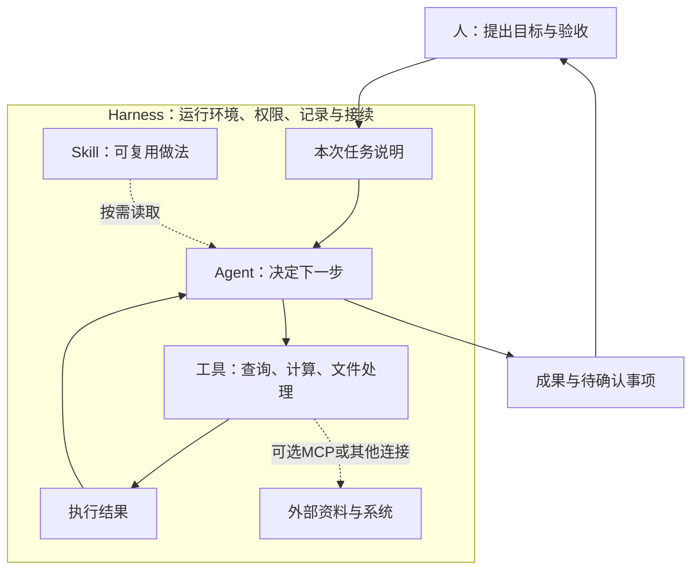

# 30页科普型内容分镜

2026-11-12候选；基于11月9日分镜重新分配，不修改旧稿。主线是“认识能力与入口→说清任务→理解组件协作→看到成果与开始方式”。提示词仍为最长的单一方法章节，会议不再贯穿整场。每页完整口语见[speaker_script.md](speaker_script.md)，原件定位见[source_map.md](source_map.md)。

## 内容配比与节奏

|页码|主题|分钟|
|---|---|---:|
|01—07|工作入口、大模型直觉与演变|10|
|08—15|提示词：客户介绍、资料比较、报价与PPT反馈|13|
|16—23|Agent、Skill寻找使用、MCP、Harness与协作|13|
|24—28|办公Agent、会议成果与PPT三类入口|9|
|29—30|工作边界与第一次尝试|3|

内容48分钟；问答5分钟，机动2分钟，共55分钟。都是预算，未真人计时。页内动作时间用于读素材、指图和短思考，不是等待网络或产品生成；现场无需登录也能完整讲述。

## 与11月9日草案的主要变化（Agent提案）

- 开场从单一会议任务改为三类交付；先让不同部门找到与自己的关联。
- 提示词保留8页，分散到客户介绍、资料、报价和页面反馈，避免连续八页训练同一张表。
- Skill从一页扩为定义、查找、使用三页；MCP与Harness用一张组合图收束。记忆与Hook合为一页，降低工程细节比重。
- 已有O1成果仅负责会议段，不占据所有产品入口；报价原答负责真实错误辨析。
- 讲者用本人视角讲PPT返工经验。核验过程移到标签和编者栏，口语强调收获与做法。

## 视觉交接规则

本稿只交内容，不替代Master的设计规范。承接委托范围内选择的A“资料批注式课堂”，以材料批注、大图解释与成果局部为主。不可将30页统一排成同样的三张色块卡片；正文进入讲者备注，主屏只放一条结论与必要素材。来源链接放备注，小标签区分示意/官方/作者案例/项目实做。第9/15页适合文字批注，第21页适合关系图，第26页适合原生表格，代表页并不决定全稿内容配比。

## 第21页关系图语义参考

图是教学综合，不是任何产品内部结构或组件强制清单。Skill不画成权限授权器；MCP不画成更高一代Agent；Harness不画成一个自动全知的大脑。未核公司连接用虚线或不画公司具体系统。

## 逐页制作输入

## 01｜今天多认识几种AI工作的方式

**预算：** 1分钟（口语50秒，观察10秒）。

**带走：** 知道有哪些入口、能交什么，以及如何开始。

**主屏与素材：** 一句标题；下方三件成果剪影“资料比较表／会议纪要／可编辑PPT”。使用文字示意，标注“本次介绍范围”；会议文件可取L03，其余不伪装成产品截图。

**依据：** L01、L03；教学组织提案。

**缺口：** 新PPT效果尚待视觉审阅；不展示未生成的成品。

**收束与过渡：** 先从大家每天会碰到的三类交付说起。

## 02｜三类入口，三种看得见的成果

**预算：** 1.5分钟（口语65秒，指图25秒）。

**带走：** 按交付物认识工具，不靠品牌排名。

**主屏与素材：** 三行对照：办公Agent→资料与文件→比较表/报告；会议入口→记录与补充→纪要/待办；PPT入口→受众与素材→页面/讲稿。L01、L03及本页原创关系图。

**依据：** O02、O04、O05、O06、L03；仅类别介绍。

**缺口：** 不是同题产品横评，不填速度、价格或成功率排名。

**收束与过渡：** 要判断这些入口能帮到哪里，先用一分钟建立对大模型的直觉。

## 03｜大模型怎样接着你的材料生成回答

**预算：** 1.5分钟（口语75秒，指图15秒）。

**带走：** 训练形成能力，本次上下文影响本次输出。

**主屏与素材：** 左侧“训练中学习规律→模型”，右侧“本次要求＋材料→生成回答”；两条过程分开。下方教学句“请把这段说明改成新同事看得懂的版本”。

**依据：** O01、O12、L07；文字生成直觉，非完整架构图。

**缺口：** 不讲未经核验的参数量；不将所有多模态系统简化成只会补字。

**收束与过渡：** 这也解释了，模型不错，为什么换个产品体验仍然可能差很多。

## 04｜模型、产品与Agent，各负责什么

**预算：** 1.5分钟（口语70秒，指图20秒）。

**带走：** 模型能力只是工作体验的一部分。

**主屏与素材：** “模型：理解与生成”“产品：界面、文件和工具入口”“Agent：围绕目标决定下一步”三处注释，同一资料整理任务贯穿；示意而非产品内部架构。

**依据：** O02、O03、O04、L08。

**缺口：** 不把Agent限定为某一种界面或某家产品。

**收束与过渡：** 接下来最容易误会的，是“文件已经在那里”和“AI已经读过它”。

## 05｜上下文，是它这次实际拿到的线索

**预算：** 1.5分钟（口语65秒，阅读25秒）。

**带走：** 指明材料、版本和用途，确认关键约束被读取。

**主屏与素材：** 教学桌面图：本次要求、选中的文件、工具返回；旁边未选文件用虚线。只画“可用/已读”的区别；不画全盘自动扫描。

**依据：** O01、O13、L08；可展示L01的“视频暂缓”一句。

**缺口：** 公司知识库只作为用户描述的环境，不声称已接入或能搜全。

**收束与过渡：** 即使材料齐了，回答看起来很确定，也还需要一种简单的核对习惯。

## 06｜流畅的回答，也会悄悄改变确定程度

**预算：** 1.5分钟（口语60秒，阅读30秒）。

**带走：** 检查事实、推断与未知是否混在一起。

**主屏与素材：** L02 M08原句“接口出现两次超时，可能是限流，原因尚未确认”；旁边两个原创改写：“已确认限流导致故障”（错误示意）／“出现两次超时，原因待查”（合适的概括）。

**依据：** L02原文；两个改写是教学示例，不是模型真实失败记录。

**缺口：** 不诊断实际设备或声称本例找到根因。

**收束与过渡：** 有了这些直觉，再看近几年的变化，就不容易被新名词绕住。

## 07｜变化是能力叠加，不是一代淘汰一代

**预算：** 1.5分钟（口语65秒，读图25秒）。

**带走：** 提示词、工具连接和流程复用可以共存。

**主屏与素材：** L07历史资料精简为四个代表节点：2022对话入口、2023函数调用、2024 MCP、2025 Skills与长任务框架实践。箭头用“增加用法”，底部持续横线写“任务说明与核验一直需要”。

**依据：** L07 H2/H3/H4/H6/H7及O03/O07。

**缺口：** 日期为代表公开节点，不是发明日、普及率或完整行业史；Skills泛称不绑定单一厂商首创。

**收束与过渡：** 提示词听起来技术，其实首先是一份给协作者的任务说明。

## 08｜提示词先回答：最后要拿到什么

**预算：** 1.5分钟（口语65秒，阅读25秒）。

**带走：** 从受众、用途和交付物出发。

**主屏与素材：** 原创提示对照：“帮我介绍这款产品”→“依据附上的产品资料，为首次到访客户写90秒中文介绍，先讲能解决什么问题，再讲两个特点；未提供的参数不补写”。标签“教学示例，未实际运行”。

**依据：** O01方法依据；本页提示为原创。

**缺口：** 没有实际产品资料或生成结果，不做效果对比。

**收束与过渡：** 交付物说清了，下一步就是告诉它该依据哪些材料。

## 09｜材料要交齐，也要说清怎么用

**预算：** 1.5分钟（口语65秒，阅读25秒）。

**带走：** 指明版本与冲突规则。

**主屏与素材：** L02 M02与C01并列，保留原编号；批注“原期限→已确认变更”。不展示整份会议记录。

**依据：** L02、L03；日期是模拟案例历史时间。

**缺口：** 不把任意更新文件自动视为获批准的最新决定。

**收束与过渡：** 有了正确材料，还可以用一个小例子告诉它，你希望成果长什么样。

## 10｜给一行例子，胜过一串形容词

**预算：** 1.5分钟（口语65秒，阅读25秒）。

**带走：** 示例说明结构，不能替代事实。

**主屏与素材：** 原创空白比较表：“选项｜适用任务｜输入｜交付格式｜待确认”；示例行只写“产品甲（示意）｜整理资料｜两份说明｜比较表｜能否导出待核”。

**依据：** O01少样本示例原则；本页表格原创。

**缺口：** 示例行不是产品能力证据，也不是正式比较结果。

**收束与过渡：** 除了示例，再补一句“做到什么程度算完成”，结果就更容易接手。

## 11｜把“做得好”换成能检查的条件

**预算：** 1.5分钟（口语65秒，阅读25秒）。

**带走：** 验收条件来自这件工作的风险。

**主屏与素材：** 原创任务批注：公开资料比较→“每项结论带出处”；报价比较→“总价与推荐一致”；PPT→“标题可改、文字可读”。取L04两笔总价作为事实小样。

**依据：** L03、L04、L09；教学归纳。

**缺口：** 不是统一强制模板，不承诺检查能消除全部错误。

**收束与过渡：** 但有些条件，材料本身就不足以判断，怎么办？

## 12｜缺信息时，先分清能做与不能下结论的部分

**预算：** 1.5分钟（口语60秒，阅读30秒）。

**带走：** 保留未知，继续有依据的部分。

**主屏与素材：** L04报价表三行：甲8655元/6天，乙8640元/8天，丙8280元/交期未知；上方需求“60件，8天内”。用箭头指丙的未知，而非画采购批准。

**依据：** L04与L05；模拟报价，税口径仅沿案例输入计算。

**缺口：** 不代用户采购；不将未给的折扣、税率、运输条件补入。

**收束与过渡：** 下面看一段真实回答，为什么连金额算对了，也不能直接交出去。

## 13｜真实回答：数字正确，结论仍会打架

**预算：** 2分钟（口语75秒，读原文与对照45秒）。

**带走：** 核对正文、表格与最终建议的一致性。

**主屏与素材：** L04第二轮e1_a_raw.md首句“建议选甲……甲最便宜”与末段“乙比甲便宜15元，因此应选乙”；中间保留8655/8640两行。页脚L05局限；用角标注明第一轮A本已正确。

**依据：** L04原始回答、L05评分修订与独立复核。

**缺口：** 同聊天A/B可见、工具不同，非随机盲测；不算准确率提升或人工节时。

**收束与过渡：** 找到问题以后，怎样反馈，才能让下一版真正改到点上？

## 14｜反馈说清对象、问题和目标

**预算：** 2分钟（口语80秒，示例对照40秒）。

**带走：** 修改建议要能指向具体对象。

**主屏与素材：** 原创PPT反馈对照：“不够高级”→“这一页只讲一个结论；把流程放大，长段落移到备注；保留三个关键数字；改后按现场视距检查”。L09质量反馈仅作背景，不伪造改后截图。

**依据：** L09、L10；具体反馈文案为教学提案。

**缺口：** 尚未验证该反馈必然改善成品；新视觉是否通过由用户判断。

**收束与过渡：** 到这里，可以把这些方法收成一段不依赖某个产品的任务说明。

## 15｜一段能带走的任务说明

**预算：** 1.5分钟（口语55秒，阅读提示35秒）。

**带走：** 目标、材料、交付、边界、检查可以自然写成一段话。

**主屏与素材：** 下方原创新提示全文，分五处小批注；标“资料整理教学示例，未运行”。

**依据：** O01方法、L03/L05项目经验；不标成已实测提示。

**缺口：** 需用户替换真实文件名与业务字段，不能直接当现成能力保证。

**收束与过渡：** 任务说明清楚后，Agent怎样把它推进成成果？

## 16｜Agent是一个会看结果再往下做的循环

**预算：** 1.5分钟（口语65秒，指图25秒）。

**带走：** 围绕目标读取、执行、检查，必要时调整。

**主屏与素材：** 原创循环“读材料→决定下一步→调用工具→看结果”，出口“交付／请求必要信息／停止”；旁注“示意，不是全部产品的精确实现”。

**依据：** O03、L08、L03。

**缺口：** 不把自动继续等同于无限运行或保证完成。

**收束与过渡：** 先看Skill，它解决的是“这种工作通常怎么做”。

## 17｜Skill，把一套做法保存成可复用说明

**预算：** 1.5分钟（口语65秒，读局部25秒）。

**带走：** Skill可包含说明、参考和脚本，内容质量需要检验。

**主屏与素材：** L11真实SKILL.md的name/description和“日常执行”局部；旁边原创文件夹示意“说明／参考／可选脚本”。只展示适用范围与两步，不贴整页代码。

**依据：** O08、L11；Master作为另一个已选流程例子见L10。

**缺口：** 保存成Skill不代表流程已验证；项目Skill不承诺迁移后自动安装。

**收束与过渡：** 那么，不会写Skill的同事，应该从哪里找？

## 18｜找Skill：先找入口，再看适不适合

**预算：** 2分钟（口语85秒，阅读入口图35秒）。

**带走：** 从产品目录、官方说明或原作者仓库寻找，读输入输出与依赖。

**主屏与素材：** 三步文字路线“产品内技能/插件目录→作者原始说明→小材料试用”；O08入口简注“桌面侧栏Skills；ChatGPT用@；Codex CLI/IDE用/skills或$”。L10的PPT Master原仓库作为定位示例。

**依据：** O08、L10；2026-11-12官方文档核验。

**缺口：** 未核现场客户端布局；不能把这些入口写成所有Agent通用。星数不作质量分数。

**收束与过渡：** 找到以后，使用流程其实可以很短。

## 19｜用Skill：看说明、选中、给任务、看结果

**预算：** 2分钟（口语80秒，阅读操作卡40秒）。

**带走：** 安装、调用、成功交付是三个不同状态。

**主屏与素材：** 原创操作卡：①读适用范围与依赖；②使用实际产品支持的安装方式；③在任务中明确选中；④核对过程与成品。下方提示“请使用已安装的××，先说明会采用哪几步，再处理这份材料”。

**依据：** O08；L10说明已选路线与准备边界。

**缺口：** 未运行现场安装；不凭空写包名或给未知脚本执行命令。

**收束与过渡：** 有了方法说明，为什么它有时仍然说“无法访问那份资料”？这就轮到连接能力了。

## 20｜MCP，连接资料和工具的一种共同约定

**预算：** 1.5分钟（口语65秒，指图25秒）。

**带走：** MCP提供连接方式，不提供凭空出现的账号权限。

**主屏与素材：** 原创示意：AI应用—连接接口—资料/计算工具；MCP只标在接口上，旁边保留“API、本地工具等其他方式”。公司知识库以虚线“设想，未接入核验”表示。

**依据：** O07、O03；非公司系统架构。

**缺口：** 无飞书、用友或公司知识库接入实测；不展示密钥或配置教程。

**收束与过渡：** 把这些组件放在一张图上，就能看见它们如何一起工作。

## 21｜Agent、Skill、MCP、Harness放到同一张工作图

**预算：** 1.5分钟（口语65秒，指图25秒）。

**带走：** 任务、方法、连接与运行支持分工合作。

**主屏与素材：** 原创图：外框Harness“运行、权限、记录、接续”；框内Agent循环，旁侧Skill“做法”、工具“读写/查询”，MCP标在可选连接上；人从上方给目标并验收，下方接成果。

**依据：** O03、O07、O09与L08；本图为教学综合。

**缺口：** Harness没有统一产品边界；并非每个系统都包含图中全部组件，不画成层层必选嵌套。

**收束与过渡：** 外围支持里，有两件与日常工作很接近：记住进度，以及在合适的时候提醒。

## 22｜记忆像交接本，Hook像定点提醒

**预算：** 1.5分钟（口语65秒，阅读25秒）。

**带走：** 长任务要保存当前决定与理由，提醒不能代替执行。

**主屏与素材：** L01脱敏摘句“科普介绍为主，视频暂缓”；一条原创交接模板“已完成／当前决定及理由／未决／下一步”；Hook只画开始读状态、结束留记录两个触点。

**依据：** L01、L11；项目实践，不讲跨产品通用配置。

**缺口：** 不展示个人全局记忆，不把提示注入当作任务已执行；Hook当前产品功能不作额外推广。

**收束与过渡：** 有了共同的任务和交接记录，多个聊天才更容易合作。

## 23｜多聊天协作，要拆开工作，也要收得回来

**预算：** 1.5分钟（口语65秒，指图25秒）。

**带走：** 适合并行的工作分开做，主线和版本有人收拢。

**主屏与素材：** L01分工简图：内容稿／工具试用／三页制作→主对话审阅；每支标独立产物。省略全部聊天ID和内部任务号。

**依据：** L01实际委派、L11；L08关于多步任务的工程观点。

**缺口：** 并行不等于必然更快；不称完全隔离、科学盲测或自动共识。

**收束与过渡：** 现在回到具体入口，先看办公Agent如何开始第一项文件任务。

## 24｜办公Agent：从一个材料文件夹开始

**预算：** 2分钟（口语80秒，读任务路线40秒）。

**带走：** 选工作范围，交材料，指定成果，打开结果。

**主屏与素材：** 三列小入口卡：Codex“本项目做过文件交付”；WorkBuddy“官方办公任务入口，待同题实测”；ChatGPT Work“官方通用工作入口，未在本项目同题验证”。下方原创最小目录示意input/output与第15页提示。

**依据：** O02、O04、O05、L03；分类不是购买推荐。

**缺口：** 本轮不操作应用；当前账号和按钮现场核对；无多产品同题结论。

**收束与过渡：** 如果任务来自会议，我们还要区分“把声音变文字”和“把文字变成行动”。

## 25｜会议：转写、纪要、行动是三件事

**预算：** 2分钟（口语80秒，指图40秒）。

**带走：** 录音转写解决记录，纪要和待办需要进一步整理与确认。

**主屏与素材：** 原创三段图“录音/转写→已确认决定→待办与未知”；两条入口：“已有文字→文件Agent”“已有会议平台→其官方转写/纪要与授权连接”。O06腾讯会议Skill官方路线仅作一条具体选项。

**依据：** O06、L02、L03。

**缺口：** O1没有录音或转写测试；腾讯会议授权与连接尚未本项目运行，费用、账号支持另核。

**收束与过渡：** 这是本项目保存下来的纪要和Excel，先看能拿到什么。

## 26｜看成果：一页纪要与一份可编辑工作簿

**预算：** 1.5分钟（口语65秒，成果阅读25秒）。

**带走：** 从原文追到成果的关键字段。

**主屏与素材：** L03纪要“待办”三行与工作簿“行动清单”A6:E8；L02 M02/C01作为旁侧日期依据。优先用原生表格重建同值，保留“模拟材料，Codex实际生成”。备用已保存PNG见source_map。

**依据：** L02、L03；Excel副本修改保存重开记录。

**缺口：** 不是其他产品实测；未测试公式、录音识别或真人节时；现场不开文件也可讲清。

**收束与过渡：** 最后一类入口是PPT，它的难点不只在生成页面。

## 27｜做PPT：先看交付路线，再看画面

**预算：** 2分钟（口语80秒，路线比较40秒）。

**带走：** 办公套件、网页生成和Skill流程是不同入口，需检查最终交付。

**主屏与素材：** 三行路线：PowerPoint Copilot→现有模板与内容；Gamma→网页卡片与PPTX导出；PPT Master→流程说明与原生PPTX制作。每行仅列一个首要检查点：模板占位符／导出后的样子／实际对象与备注。

**依据：** O10、O11、L10；T01是第三方有商业关联的操作案例，单独脚注。

**缺口：** 无同题胜负；不引用套餐价；WPS仅随附候选，原页本轮超时，不讲当前按钮教程。

**收束与过渡：** 我们自己的PPT制作，也正是在这个地方得到了一次很直接的教训。

## 28｜本次制作的教训：先看三页，再扩整套

**预算：** 1.5分钟（口语65秒，读流程25秒）。

**带走：** 内容、视觉和技术检查分别进行。

**主屏与素材：** L09事实“旧稿技术检查通过部分项目，用户创作质量否决”；原创流程“内容分镜→三页代表稿→反馈→整套”。L10两份参考的局部图可选作设计参考，必须注明作者案例，不冒充本次成品。

**依据：** L01、L09、L10；状态以本稿核验时的任务说明为准。

**缺口：** 三页与新整套制作由并行聊天负责；未核新产物，不讲“已认可”“已定稿”。

**收束与过渡：** 最后两页，回到每个人怎样开始，以及哪些决定仍要自己掌握。

## 29｜让AI多做准备，把重要决定留给人

**预算：** 1.5分钟（口语65秒，案例判断25秒）。

**带走：** 分清准备、执行和对外承诺。

**主屏与素材：** 原创三组短对照“写邮件→确认后发送”“比较报价→按流程采购”“整理资料→核对后对外使用”；旁注“按本单位实际数据与授权规则”。

**依据：** L03任务边界、L01范围；一般工作建议，不冒称公司已发布制度。

**缺口：** 未审查公司政策、产品数据条款或系统权限，不做法律与合规结论。

**收束与过渡：** 如果明天只试一次，我建议选一个熟悉、能判断结果的小任务。

## 30｜从一份材料、一个成果、一次检查开始

**预算：** 1.5分钟（口语70秒，个人选择20秒）。

**带走：** 选择自己的第一项可核对工作。

**主屏与素材：** 三个任选入口“产品资料→接待介绍”“会议记录→决定与待办”“汇报大纲→三页样稿”；底部指向本包start_here.md与第15页提示，不生成未发布二维码。

**依据：** 本稿教学归纳、L01；可下载材料见source_map。

**缺口：** 不是作业承诺；首次试用时间与效果因任务、环境而异。

**收束与过渡：** 进入5分钟问答；若没有提问，可请一位同事说出任务、材料和期望成果，一起改成一句可执行的要求，不现场承诺账号或功能可用。
