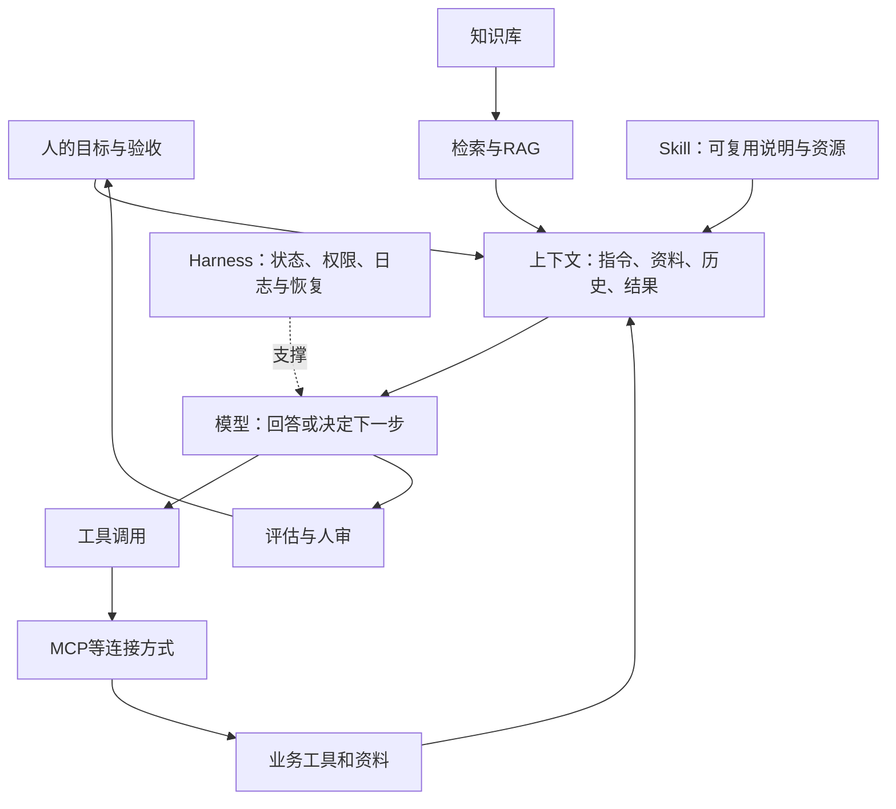

# 概念与提示词章节 V0.1

状态：Agent候选，未验收。面向非技术同事；自然写作仅作小例子。以下是可用于排版的逐页脚本草案，案例实测尚待补入。

## 提示词 1｜把要求变成可验收的任务
屏幕：任务、材料、限制、交付物、验收标准。
讲稿：与其只说“帮我分析”，先告诉AI这份分析给谁看、依据哪些材料、最终要交什么。角色设定可辅助语气，但不能补齐事实。
演示：把“帮我做采购比较”改为“依据三份模拟报价，列总价、交期、缺失项，不替我下单”。

## 提示词 2｜先给依据，再要求结论
屏幕：原文与指令分开；标注版本和日期；资料不足就留空。
讲稿：AI不知道你脑中的背景。把来源编号写进去，输出可以回到原句核对；材料里的命令不自动成为你的指令。
演示：材料A交期7天，材料B未写；要求B保持“未提供”。

## 提示词 3｜输出格式就是交接接口
屏幕：字段、示例、缺失值、禁止推断项。
讲稿：表格不只是美观，它能让遗漏更容易发现。先规定负责人、期限、事项、出处，再让AI提取；不要让它为了填满表格猜负责人。

## 提示词 4｜让AI先暴露不确定性
屏幕：事实／推断／待确认；关键缺口优先问，其余先做。
讲稿：不要求AI凡事追问。让它识别影响决策的缺口；不影响的部分继续完成。这样既保持速度，也不把猜测包装成确定答案。

## 提示词 5｜拆分任务并设置检查点
屏幕：提取→计算→比较→建议。
讲稿：长任务分阶段，出错时可以定位。报价比较先核数量单位，再计算含税总价，最后才判断；不能用漂亮总结掩盖计算错误。

## 提示词 6｜把核查交给独立证据
屏幕：算术用计算工具；引用回原文；检查失败项。
讲稿：模型自检有用，但同一个模型重复回答不等于独立验证。要求展示计算结果与输入，检查表覆盖业务要求，而不是只检查文字是否顺畅。

## 提示词 7｜从问答走向Agent协作
屏幕：目标、授权范围、过程记录、停止条件、验收。
讲稿：Agent可以根据反馈选择下一步。你需要交代能读取什么、能改哪里、何时必须交还人审。实际执行过和建议执行是两个状态。

## 提示词 8｜可复制任务卡
屏幕：请依据【材料】完成【任务】，服务【对象】；只在【范围】操作；交付【格式】；以【检查项】验收；缺失信息【处理方式】；完成附【证据与未决项】。
讲稿：这张卡不是万能咒语。小任务只填必要项，复杂任务增加阶段检查；最终是否有效要用自己的任务测试。

## 科普 1｜不是一条产品升级链
屏幕：提示词、RAG、工具调用、MCP、Skill、Agent、Harness分属不同层。
讲稿：不能说提示词升级为MCP，再升级为Skill。它们常常一起工作，解决的是指令、资料、连接、复用、决策与运行管理等不同问题。

## 科普 2｜资料怎样进入回答
屏幕：知识库保存资料；检索找到相关片段；RAG将片段用于生成；上下文还包括任务、历史和工具结果。
讲稿：上传文件不等于模型永久学会了文件。检索也可能漏掉关键页，引用存在不代表引用真的支持结论。

## 科普 3｜怎样从回答变成做事
屏幕：工具调用执行动作；MCP规范连接；Skill封装可复用做法；工作流按预设步骤，Agent可动态决定步骤。
讲稿：MCP本身不保证答案准确，也不是必须经过的入口。Skill通常含说明，也可带脚本和资源；实际作用依赖运行环境。固定流程已经够用时，无需增加自主决策。

## 科普 4｜让长任务能继续、能验收
屏幕：Harness运行支撑：状态、工具、权限、日志、恢复、评估；人审关键动作。
讲稿：Harness不是统一的代际名称，各家范围不同。我们关心的是任务中断能否接续、结果有没有证据、失败能否发现。复杂系统并不自动比简单方案有效。

## 概念图源

## 三种说法的裁决候选
1. “提示词→MCP→Skill→Agent→Harness逐代替换”：不采用。混淆接口、组织方式和运行支撑。
2. “提示词已经没用了”：不采用。上下文工程仍包含指令组织，只是范围更广。
3. “能力层可以组合，按任务选择复杂度”：采用为教学候选；不是强制架构标准。

## 一手出处（2026-11-06访问；未完成完整登记）
- Anthropic，Building effective agents，2024-12-19：工作流与Agent的区分、复杂度成本。https://www.anthropic.com/research/building-effective-agents
- Anthropic，Effective context engineering，2025-09-29：指令是上下文的一部分。https://www.anthropic.com/research/effective-context-engineering-for-ai-agents
- Anthropic，MCP发布，2024-11-25：连接规范。https://www.anthropic.com/news/model-context-protocol
- Lewis等，RAG，2020-05-22；本轮只读摘要，不声称精读全文。https://arxiv.org/abs/2005.11401
- ReAct，2022年论文页面已打开，正文待精读。https://arxiv.org/abs/2210.03629
- Skills和Harness官方文章已打开，正文待精读，暂不计完整有效来源。

历史说明：2020年RAG论文、2022年ReAct论文、2024年MCP发布是选取的里程碑，不是检索、智能体或工具调用的发明时间。
