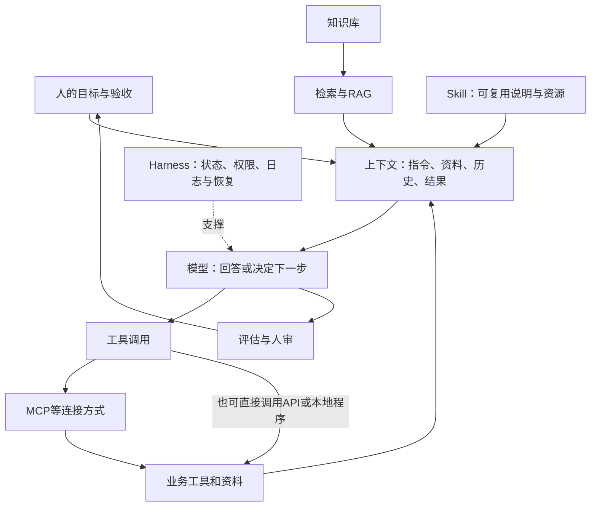

# 概念与提示词章节 V0.2

状态：待主对话审阅候选。8页提示词+4页科普，前三页连续报价案例。案例是当前会话作答加工具执行，不是两次独立模型实验。完整限制见experiments/comparison_report.md，来源见evidence_ledger.md与claim_matrix.md。

## 提示词 1｜从一句话到工作结果

备注出处：本地E1原始作答：experiments/session_outputs.md；演示局限：comparison_report.md。
屏幕左：请比较报价，给个建议。右：当前会话实际输出已正确识别A满足交期、C最便宜但逾期。先承认基线也可能答对，再展示它缺少可直接复核的明细。
讲稿：AI的价值不只是替我们写一句建议。我们希望把报价材料变成采购同事可以继续核对的文件。第一步先明确这份工作最后交什么。

## 提示词 2｜给同一任务补齐材料与标准

备注出处：本地E1输入：experiments/quote_input.json；提示词：protocol.md。
屏幕：100件、9天内交付、含税到货总价。A未税80、13%税、运费200；B含税88、运费500、交期未知；C含税90、免运费、10天。
讲稿：把口径写清楚，模型才知道不能直接按单价排序。改进提示词要求公式、未知项和交期判断。此处展示的是同一会话作答，不是提示词因果实验。
产物：experiments/session_outputs.md 的E1表格。

## 提示词 3｜让工具生成可交接文件

备注出处：真实执行：quote_run.json、quote_output_check.json；工具分工来源S12。
屏幕：输入JSON→Python读取并计算→采购比较Markdown→缺口清单。
讲稿：模型可以组织任务、生成程序、调用工具并读取结果；程序把重复计算变成可复跑步骤。本轮实际运行会保存输入、输出、执行报告。这样的产物比聊天里的一句话更容易交接；但只覆盖模拟报价，未接入采购系统。
现场路径：experiments/quote_input.json、quote_deliverable.md、quote_run.json；运行命令python scripts/concepts/run_quote_workflow.py。

## 提示词 4｜让AI先暴露不确定性

备注出处：S2上下文管理；本地E2/E3；这是交接建议，不是性能提升结论。
屏幕：事实／推断／待确认；关键缺口优先问，其余先做。
讲稿：不要求AI凡事追问。让它识别影响决策的缺口；不影响的部分继续完成。这样既保持速度，也不把猜测包装成确定答案。

## 提示词 5｜拆分任务并设置检查点

备注出处：S1工作流Prompt chaining章节；E1计算流程。
屏幕：提取→计算→比较→建议。
讲稿：长任务分阶段，出错时可以定位。报价比较先核数量单位，再计算含税总价，最后才判断；不能用漂亮总结掩盖计算错误。

## 提示词 6｜把核查交给独立证据

备注出处：S8评估区分输出与最终状态；本地check_quote_output.py。
屏幕：算术用计算工具；引用回原文；检查失败项。
讲稿：模型自检有用，但同一个模型重复回答不等于独立验证。要求展示计算结果与输入，检查表覆盖业务要求，而不是只检查文字是否顺畅。

## 提示词 7｜从问答走向Agent协作

备注出处：S1 Agent定义；S8运行状态；S19并行上下文限制。
屏幕：目标、授权范围、过程记录、停止条件、验收。
讲稿：Agent可以根据反馈选择下一步。你需要交代能读取什么、能改哪里、何时必须交还人审。实际执行过和建议执行是两个状态。

## 提示词 8｜可复制任务卡

备注出处：Agent整理的教学模板；效果未独立验证，不标为来源原文。
屏幕：请依据【材料】完成【任务】，服务【对象】；只在【范围】操作；交付【格式】；以【检查项】验收；缺失信息【处理方式】；完成附【证据与未决项】。
讲稿：这张卡不是万能咒语。小任务只填必要项，复杂任务增加阶段检查；最终是否有效要用自己的任务测试。

## 科普 1｜不是一条产品升级链

备注出处：S1/S3/S6/S8定义对照；V2 08:08至09:07。
屏幕：提示词、RAG、工具调用、MCP、Skill、Agent、Harness分属不同层。
讲稿：不能说提示词升级为MCP，再升级为Skill。它们常常一起工作，解决的是指令、资料、连接、复用、决策与运行管理等不同问题。

## 科普 2｜资料怎样进入回答

备注出处：S4摘要级历史依据；S2上下文定义；S14知识管线。
屏幕：知识库保存资料；检索找到相关片段；RAG将片段用于生成；上下文还包括任务、历史和工具结果。
讲稿：上传文件不等于模型永久学会了文件。检索也可能漏掉关键页，引用存在不代表引用真的支持结论。

## 科普 3｜怎样从回答变成做事

备注出处：S12函数调用；S3 MCP；S6及V2 Skills；S1工作流。
屏幕：工具调用执行动作；MCP规范连接；Skill封装可复用做法；工作流按预设步骤，Agent可动态决定步骤。
讲稿：MCP本身不保证答案准确，也不是必须经过的入口。Skill通常含说明，也可带脚本和资源；实际作用依赖运行环境。固定流程已经够用时，无需增加自主决策。

## 科普 4｜让长任务能继续、能验收

备注出处：S7长任务运行支持；S8 harness定义；S9与S19相反立场条件对照。
屏幕：Harness运行支撑：状态、工具、权限、日志、恢复、评估；人审关键动作。
讲稿：Harness不是统一的代际名称，各家范围不同。我们关心的是任务中断能否接续、结果有没有证据、失败能否发现。复杂系统并不自动比简单方案有效。

## 概念图源

## 三种说法的裁决候选
1. “提示词→MCP→Skill→Agent→Harness逐代替换”：不采用。混淆接口、组织方式和运行支撑。
2. “提示词已经没用了”：不采用。上下文工程仍包含指令组织，只是范围更广。
3. “能力层可以组合，按任务选择复杂度”：采用为教学候选；不是强制架构标准。

## 一手出处（2026-11-06访问；完整登记见evidence_ledger.md）
- Anthropic，Building effective agents，2024-12-19：工作流与Agent的区分、复杂度成本。https://www.anthropic.com/research/building-effective-agents
- Anthropic，Effective context engineering，2025-09-29：指令是上下文的一部分。https://www.anthropic.com/research/effective-context-engineering-for-ai-agents
- Anthropic，MCP发布，2024-11-25：连接规范。https://www.anthropic.com/news/model-context-protocol
- Lewis等，RAG，2020-05-22；本轮只读摘要，不声称精读全文。https://arxiv.org/abs/2005.11401
- ReAct，2022年论文页面已打开，正文待精读。https://arxiv.org/abs/2210.03629
- Skills与Harness已读取相关正文，见来源S6/S7；视频V2补充Skills原作者解释。

历史说明：2020年RAG论文、2022年ReAct论文、2024年MCP发布是选取的里程碑，不是检索、智能体或工具调用的发明时间。

## 编排建议
提示词8页约14分钟：前三页5分钟、其余各约1至2分钟；科普4页约6分钟。时间为讲稿估计，未完成真人试讲计时。

## 中文阅读入口
Qwen函数调用(S12)解释模型与执行程序分工；Dify工作流(S13)与知识管线(S14)帮助把概念映射到画布和资料处理。均不构成本项目产品推荐。
